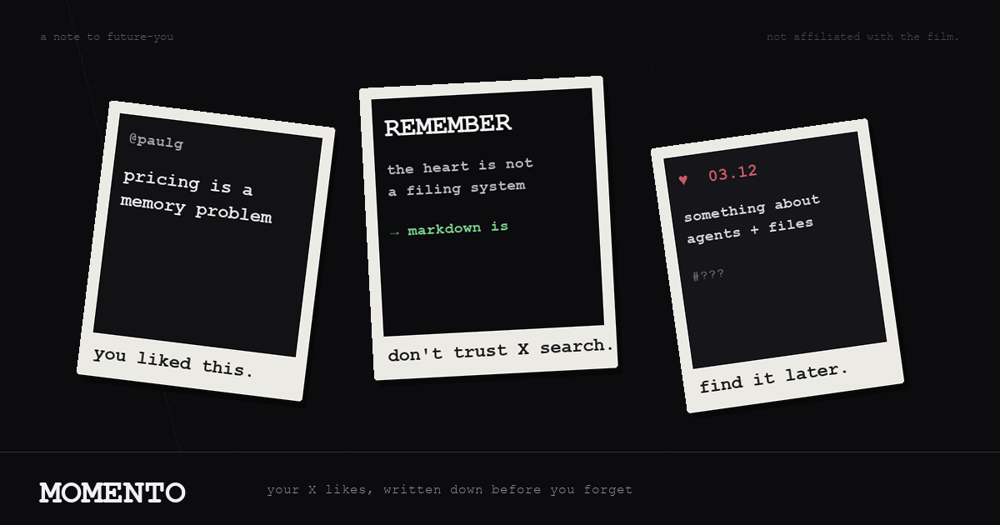

# momento

> Watch the bookmarks. Extract the work. Write back every morning.



<p align="center"><sub>Like the film: you won't remember. Write it down.<br/>Not affiliated with <i>Memento</i> (2000) — just stealing the bit about external memory.</sub></p>

Momento keeps an eye on **X Bookmarks only**. Hearts can still be stored, but they do not drive the product.

Every bookmark is expanded: the tweet, the outbound link, the article text, images, and a vector index. Then Momento comes to you — a daily brief in the app, in your email, and as a spoken script.

- Chrome extension for the first bookmark sync and hourly refresh
- Article extraction into the local vault
- Automatic QMD lexical + vector index
- Daily brief, insights, and podcast script
- Optional email via Resend
- Grounded local answers with citations via llama.cpp
- Plain markdown mirror for Obsidian and local agents
- Local-first: browser cookies never leave the extension

## Interface

The mobile PWA uses the requested shadcn preset:

```bash
bunx --bun shadcn@latest init --preset b3Zheoix4U --template next
```

It lives in [`web/`](./web): Next.js 16, Base UI primitives, the `base-sera` style, stone tokens, Oxanium/Geist type, and Phosphor icons. The production export is committed so `momento serve` stays zero-dependency.

## Quick start

Requires Node 20+ and Chrome/Arc/Brave/Edge.

```bash
git clone https://github.com/gvkhosla/momento.git
cd momento
npm link
momento configure --email you@domain.com
momento serve
```

Open [http://localhost:4177](http://localhost:4177).

To email the brief, copy `.env.example` to `.env` and replace `re_xxxxxxxxx` with your real Resend API key:

```bash
cp .env.example .env
# edit .env: RESEND_API_KEY=re_xxxxxxxxx  →  your real key
```

## Sync X Bookmarks

1. Download `momento-extension-v0.4.0.zip` from the [latest release](https://github.com/gvkhosla/momento/releases/latest) and unzip it—or use the local `momento/extension` folder
2. Open `chrome://extensions`
3. Enable **Developer mode**
4. **Load unpacked** → select the unzipped extension folder
5. Stay signed in at [x.com](https://x.com)
6. Open the Momento extension
7. Leave **Bookmarks** checked → **Sync selected**

The first sync is explicit because Momento must capture X's current private GraphQL configuration from your signed-in browser. After bookmarks have synced once, the extension watches X. Saving a bookmark, opening `/i/bookmarks`, or waiting a few minutes is enough — new items land in the vault, get extracted, and show up in Today. Incremental syncs stop after a handful of already-known items.

New bookmarks are extracted in the background: Momento follows the outbound link, stores the article, downloads the hero image when it can, and refreshes the vector index.

If X config capture fails, open your Bookmarks page once, let it load, then retry. X cookies remain inside the extension; only normalized records are written to the local Momento API.

## Daily brief

While `momento serve` is running, Momento:

1. Extracts any unread bookmark links
2. Rebuilds the QMD index when new article text lands
3. Writes today's brief after your configured local hour
4. Emails it when `RESEND_API_KEY` and an address are set

```bash
momento configure --email you@domain.com --hour 7
momento brief              # write today's brief now
momento brief --send       # write and email it
momento brief --speak ~/Desktop/momento.m4a
```

The app home screen is the brief, not the search box. Search and Ask are still there when you want them.

## Use it on your phone

Create a temporary secure URL to the archive running on your Mac:

```bash
momento phone
```

Open the printed HTTPS URL on your phone. Keep the terminal open.

From there you can:

- Read today's brief
- Search extracted bookmarks
- Add an X URL directly
- Install Momento to your Home Screen
- Share into Momento on browsers that support PWA share targets

Your archive still lives at `~/momento-vault`; the tunnel only exposes the running app while the command is open.

> For a permanent multi-user cloud product, Momento needs accounts and an encrypted sync backend. This release deliberately keeps your X session and archive local.

## Search and local answers

Instant keyword search remains available and now includes extracted article text:

```bash
momento search "the thread about pricing"
momento search "design systems" --source bookmark
```

Deep search uses QMD's BM25 + vector retrieval. Momento creates and refreshes the collection after extraction:

```bash
momento index
momento search "charging customers based on usage" --deep
```

`--deep` sends a structured `lex` + `vec` query to QMD and skips query expansion and reranking by default. Add `--rerank` when you want slower local reranking.

The web app has three modes:

- **Today** is the daily brief.
- **Search** finds bookmarks and extracted articles.
- **Ask** retrieves the strongest items first, synthesizes only from that evidence with a local GGUF model, and displays the exact reference cards it used.

```bash
brew install llama.cpp
export MOMENTO_MODEL=~/models/your-instruct-model.gguf
momento ask "What patterns have I bookmarked about reliable agents?"
```

Momento automatically chooses the smallest `.gguf` in `~/models` when `MOMENTO_MODEL` is unset. QMD is preferred for evidence when configured; otherwise `ask` falls back to keyword evidence.

```bash
momento enrich --limit 40
momento stats
momento path
momento open
```

## What is stored

Each unique tweet becomes one markdown file. When the outbound article is extracted, that text is appended:

```markdown
---
id: "1900123456789012345"
url: https://x.com/paulg/status/1900123456789012345
author: "@paulg"
author_name: Paul Graham
date: 2025-03-12T14:22:00.000Z
saved_at: 2026-07-28T08:30:00.000Z
sources: ["bookmark"]
bookmarked_at: 2026-07-28T08:30:00.000Z
extracted_title: Relentlessly resourceful
extracted_site: paulgraham.com
extracted_status: ready
---

The best founders are relentlessly resourceful.

## Relentlessly resourceful

_paulgraham.com_

[https://paulgraham.com/relres.html](https://paulgraham.com/relres.html)
```

Archive layout:

```text
~/momento-vault/
├── items.json       # canonical merged archive
├── README.md
├── by-id/           # agent/Obsidian-friendly markdown
├── briefs/          # daily brief json + markdown
└── media/           # downloaded article images
```

## Phone capture

The PWA declares a Web Share Target. You can also paste a tweet URL into **Add a link** and choose whether to remember it as a Bookmark or Heart.

For an iOS Shortcut, create a Share Sheet shortcut that:

1. Receives **URLs** from the Share Sheet
2. Uses **Get Contents of URL** on `https://YOUR_TUNNEL/api/capture?token=YOUR_PAIRING_TOKEN`
3. Method: `POST`
4. JSON body: `{ "url": "Shortcut Input", "source": "bookmark" }`

Copy the tunnel host and pairing token from the URL printed by `momento phone`.

The temporary `trycloudflare.com` URL and pairing token change each time. A permanent hosted version will remove that limitation.

## Agent skill

Drop [`skill/SKILL.md`](./skill/SKILL.md) into your agent skills directory. Then ask:

> Find the article I bookmarked about usage-based pricing.

The agent uses `momento search` or reads `~/momento-vault/by-id`. For "what should I read," it should open `momento brief`.

## Commands

| Command | Job |
|---|---|
| `momento serve` | Run the PWA, local sync API, extractor, and daily bot |
| `momento phone` | Create a secure temporary phone URL |
| `momento search <query>` | Instant keyword search |
| `momento search <query> --deep` | QMD hybrid lexical + vector search |
| `momento ask <question>` | Answer from saved posts locally |
| `momento enrich` | Extract linked articles from bookmarks |
| `momento index` | Refresh the QMD vector index |
| `momento brief [--send]` | Build today's brief, optionally email it |
| `momento configure --email` | Save daily-brief settings |
| `momento install` | Install a macOS LaunchAgent so the bot stays up |
| `momento deep-setup` | Print QMD install steps |
| `momento repair-order --source TYPE` | Repair pre-v0.3 crawl ordering |
| `momento stats` | Count unique items and sources |
| `momento seed` | Add four demo memories |
| `momento clear-demo` | Remove demo memories |
| `momento path` | Print the vault path |
| `momento open` | Open the vault |

## Privacy and constraints

- X cookies remain inside the browser extension
- The extension talks to `127.0.0.1:4177`
- Sync uses X's private web GraphQL endpoints, so X can change them
- Momento sniffs live query IDs to reduce breakage
- X omits exact save timestamps; Momento preserves the source timeline order using stable synthetic timestamps
- Article extraction fetches public pages from this machine
- Email needs `RESEND_API_KEY`; nothing is sent until you set an address
- Phone tunnels should be treated as temporary personal links

## Development

```bash
npm test
npm run check
MOMENTO_HOME=/tmp/momento-dev momento serve
```

## License

MIT
